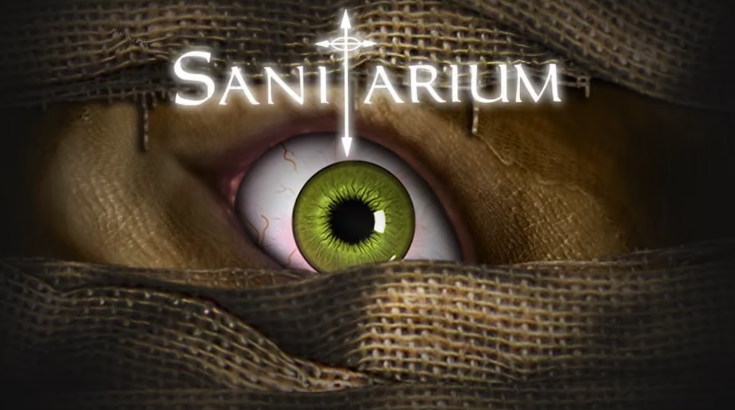
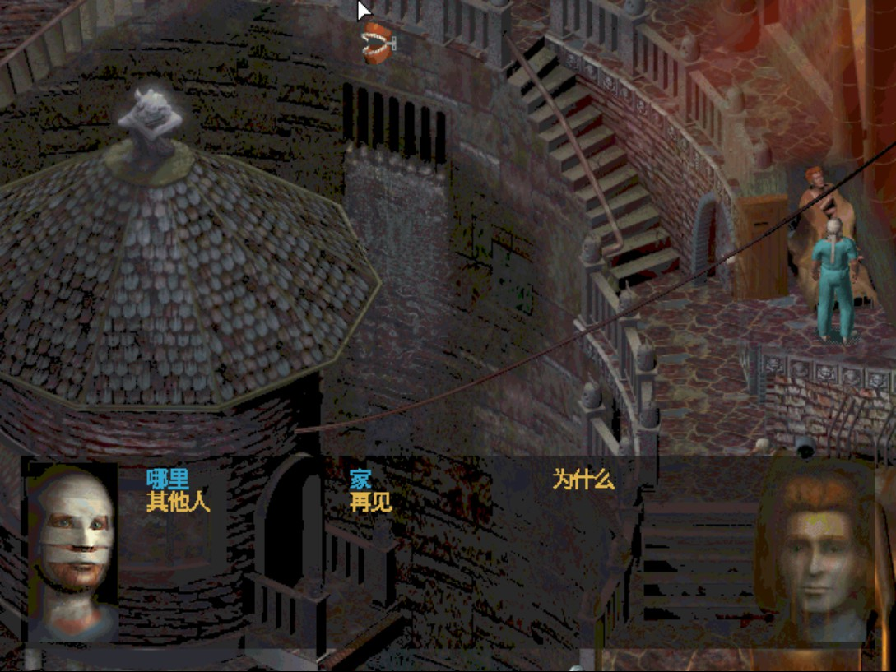
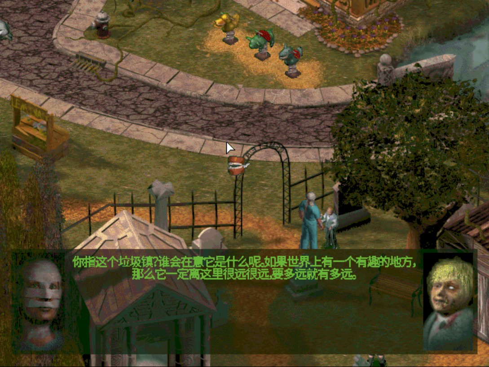

# Sanitarium（疯人院）Steam 版中文补丁

Steam 版《Sanitarium》（AppID **284050**）的「覆盖即用」中文整合补丁：全篇中文、长句自动换行、CG 字幕与字体颜色修复、窗口自适应居中、全局倍速（F6/F7/F8）。

**本仓库不包含游戏本体**，请先自行购买并安装正版。



| 实机：中文对白 | 实机：中文界面 |
| --- | --- |
|  |  |

## 下载

仓库地址：https://github.com/waldere-furnace/Sanitarium-CN

- 本仓库 ：https://github.com/waldere-furnace/Sanitarium-CN/releases/tag/v1.0.0
- 网盘备份：
  - 百度网盘：https://pan.baidu.com/s/1M1qIW77FQsJHLwvRldwaDA?pwd=ptmu 提取码 `ptmu`
  - 夸克网盘：https://pan.quark.cn/s/f20b3cb0443a?pwd=fsJs 提取码 `fsJs`

## 安装

1. 关闭 Steam 与游戏。
2. 把 `SanitariumCN.zip` 解压到游戏根目录（例如 `...\steamapps\common\Sanitarium`），提示覆盖时选**覆盖**。
3. 启动游戏，直接就是中文。

也可以运行 `dist\install.ps1`（可用参数指定游戏路径）。安装前建议备份 `Data\EN\RES.000` 与 `winmm.dll`，方便随时还原成原版。

存档在 `%APPDATA%\DotEmu\Sanitarium\SAVES\EN`，不受本补丁影响。

## 卸载

运行 `dist\uninstall.ps1`，或手动删除：

```
winmm.dll
SanitariumCN.asi
SanitariumInput.asi
SanitariumWindow.asi
SanitariumSpeed.asi
cjk_glyphs_12.bin
cjk_glyphs_16.bin
sanitarium_cfg.txt
```

并还原安装前备份的 `Data\EN\RES.000` 与 `winmm.dll`。

## 补丁包含什么

- 全篇中文：剧情对白、NPC 对白与选项、物件交互文本、菜单、读档界面、章节标题；
- 长中文自动换行，不重复、不压头像；标点规范化为全角（，。！？—……“”《》）；
- NPC 对白、对白选项、物件交互的字号修复；
- 过场 CG 字幕排版、`《幻音》` 之类发言标签、省略号修复；
- CG 鼠标跳过保护：除每次启动最先播放的那段商标/Logo CG 外，其余 CG（含进入 CG 前的准备动画）不会被鼠标误跳过，键盘跳过仍然可用；
- 窗口尺寸与自动居中：窗口过大时按 4:3 缩小并居中，避免标题栏和游戏顶部选项卡跑出屏幕；
- 全局倍速 F6/F7/F8（默认关闭，状态自动保存）。

## 操作

| 按键 | 作用 |
| --- | --- |
| `F6` | 开启/关闭全局倍速。默认关闭；首次开启若当前倍速为 1 会自动设为 2x，之后每次按 F6 记住开/关状态 |
| `F7` | 降低倍速（1–9） |
| `F8` | 提高倍速（1–9） |

倍速与开关状态写在 `sanitarium_cfg.txt`：

```ini
AnimationSpeed=2
AnimationSpeedEnabled=0
AnimationSpeedToggleKey=F6
AnimationSpeedDecreaseKey=F7
AnimationSpeedIncreaseKey=F8
```

`AnimationSpeedEnabled=0` 表示本次启动不开启倍速，按 F6 后写回 `1`，再按一次写回 `0`。

## 窗口设置

```ini
WindowWidth=1280
WindowHeight=960
WindowResizable=0
Borderless=0
```

目标尺寸超过桌面工作区时会自动按 4:3 等比缩小并居中。

## 已验证

- 完整体验通关一次（第 1–13 章），无卡死、无文字缺失；
- 长中文自动换行正常，不重复绘制、不压头像；
- 各字体颜色与游戏原版一致：主菜单金色、第一/二章蓝色、第八章 NPC 对白绿色、最终章主角蓝色等；实现方式是按字体自身字形的「调色板槽位」取墨色，游戏换场景/换文字颜色时自动跟随，同一句内不会出现混色；
- 主菜单、读档界面、NPC 选项页、物件交互文字、CG 字幕均正常；
- F6/F7/F8 倍速与设置持久化正常；
- 非开场 CG 鼠标锁 + 键盘跳过正常。

## 已知限制

- 倍速是**全局**加速，动画播放速度同样会变快，观感可能不自然；目前没有「只加速主角移动」的模式。
- `Fullscreen` 为游戏原生选项，保持 4:3 画面，不做宽屏拉伸（拉伸会变形，扩展视野需要重写内部渲染，风险过高）。
- 后续如果游戏本体更新替换了 `RES.000` 或字体资源，补丁可能需要同步更新。

## 解密切勿汉化（重要）

游戏中有几处是「英文首字母拼字」的解谜：

- 三块黑板的 `SALVATION`、`THE YOUTH`、`KEY HIDES TO`；
- Morgan 手记中的若干英文段落（资源 1068–1075）。

这些内容**刻意保留英文原文**，翻译成中文会导致谜题无法解开。其余对白、菜单和普通 UI 全部是中文。卡关时再看包内 `README.txt` 里的中英对照（含剧透警示）。

## 署名与来源

- 中文译文来源：**chinaavg**
- 汉化人员名单：
  - 技术绿色：habit、Shane007
  - 翻译工具：Alexfont
  - 文本翻译：XQ、Jin、Neo、CaesarZX
  - 文本整理：CaesarZX
  - 文本校对：Neo、XQ
  - 文本润色：Bro.ichi
- 倍速/语言补丁参考：Sanitarium Steam Language Patch v1.1（来源页 https://github.com/Deledrius/scummvm-asylum ，上游 readme 标注参考 alxpnv 的 https://github.com/alxpnv/scummvm-asylum ）。上游说明其代码实现与功能优化借助 AI（ChatGPT）完成；本整合包的汉化与加速整合为独立重实现。
- ASI 载入器：Ultimate ASI Loader（ThirteenAG，MIT License）。

## 注意事项

- **杀软误报**：补丁通过 `winmm.dll`（Ultimate ASI Loader）加载 `*.asi`，这是 ASI 系列补丁的通用做法，个别杀毒软件会误报；本补丁不改动 `Asylum.exe`，如遇拦截请加白名单。
- **Steam「校验游戏文件完整性」**：本补丁替换了文本资源 `Data\EN\RES.000`（安装脚本会自动备份为 `RES.000.sanitarium-cn.bak`）。校验完整性会把它还原成英文，重新运行 `install.ps1` 或再覆盖一次 `Data\EN\RES.000` 即可恢复中文。

## AI 辅助说明

本补丁程序的代码实现、逆向分析与调试借助 AI 编程代理（Codex + DeepSeek V4 Flash）完成，具体包括 `SanitariumCN.asi`（字库挂钩、换行排版、标点规范化、字体颜色解析）、`SanitariumInput.asi`（CG 鼠标锁）、`SanitariumWindow.asi`（窗口与居中）、`SanitariumSpeed.asi`（倍速），以及中文 8bpp 字形包与文本表的生成/改写。中文译文沿用 chinaavg 的汉化文本（非本次生成）；功能由人工在游戏内逐章验证。

## 免责声明

本补丁为爱好者非商业整合，**不包含游戏本体**，请勿重新打包分发游戏文件。游戏本体版权归原权利人（DotEmu / ASC Games 等）所有，原始中文译文版权归 chinaavg 及译者所有；本仓库仅提供安装用补丁与说明。如有侵权，请联系删除。
